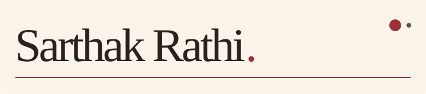
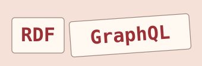
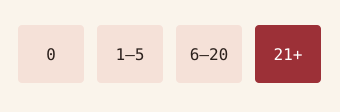
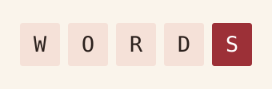
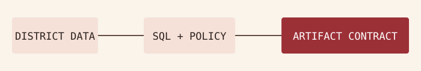
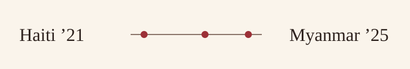
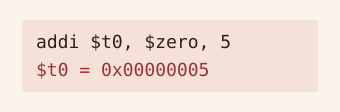
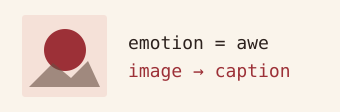
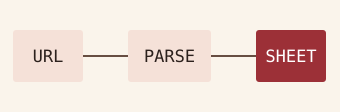
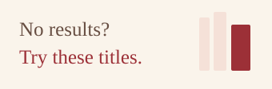

<!--
ARTWORK PALETTE
Edit ACTIVE_PALETTE near the top of generate_assets.py.
Run python generate_assets.py and commit the updated assets/ folder.
-->

<picture>
  <source media="(prefers-color-scheme: dark)" srcset="./assets/nameplate-dark.svg">
  <source media="(prefers-color-scheme: light)" srcset="./assets/nameplate-light.svg">
  
</picture>

  <strong>Building software and ML systems.</strong>

I’m a final-year Computer Science student at Ashoka University. I work across ML evaluation, data infrastructure, and software tools, with an interest in AI security and auditing.

  <em>B.Sc. Computer Science · Astronomy &amp; Entrepreneurship concentrations · May 2027</em>

  <a href="#selected-work">Selected work</a> · <a href="#more-projects">More projects</a> · <a href="#experience">Experience</a> · <a href="#tools-i-work-with">Tools</a> · <a href="#connect">Connect</a>

<blockquote>
  
Currently contributing to the SciCommons research feed with Prof. Suresh Krishna at McGill. <a href="https://feed.scicommons.org/scicommons/default">Explore the public feed</a>
  

</blockquote>

## Selected work

<table width="100%">
  <tbody>
    <tr>
      <td rowspan="2" width="50%">
        <a href="https://github.com/ironLegion88/fkg-graphql-layer/tree/sprint-2/cytoscape">
          <picture>
            <source media="(prefers-color-scheme: dark)" srcset="./assets/ifkg-dark.svg">
            <source media="(prefers-color-scheme: light)" srcset="./assets/ifkg-light.svg">
            
          </picture>
        </a>
        <h3>Food Knowledge Graph</h3>
        
A GraphQL prototype with query depth, complexity, and result limits. Comparing GraphDB and Oxigraph on 14 semantic parity cases.

        
Python · GraphQL · RDF · Oxigraph

        

          <a href="https://github.com/ironLegion88/fkg-graphql-layer/tree/sprint-2/cytoscape">Code ↗</a>
        

        

          
Evaluation notes

          
The bundled fixture has 12 matching comparisons out of 14. The two accepted differences concern relationship exposure and inferred class membership. The prototype also has RDF ingestion regression checks.

        

      </td>
      <td width="50%">
        <a href="https://github.com/ironLegion88/yelp-polyglot-ml-pipeline">
          <picture>
            <source media="(prefers-color-scheme: dark)" srcset="./assets/yelp-dark.svg">
            <source media="(prefers-color-scheme: light)" srcset="./assets/yelp-light.svg">
            
          </picture>
        </a>
        <h3>Yelp Useful-Vote Prediction</h3>
        
XGBoost with review and graph features. Stratified error analysis across vote ranges, with SHAP to examine feature reliance.

        
Python · Polars · XGBoost · SHAP

        

          <a href="https://github.com/ironLegion88/yelp-polyglot-ml-pipeline">Code &amp; analysis ↗</a>
        

      </td>
    </tr>
    <tr>
      <td width="50%">
        <a href="https://github.com/ironLegion88/word-games">
          <picture>
            <source media="(prefers-color-scheme: dark)" srcset="./assets/word-games-dark.svg">
            <source media="(prefers-color-scheme: light)" srcset="./assets/word-games-light.svg">
            
          </picture>
        </a>
        <h3>Word Games in Rust</h3>
        
Spelling Bee, Boggle, and Wordle on an arena-backed trie. Differential tests compare optimized solvers against reference implementations.

        
Rust · Cargo · Criterion

        

          <a href="https://github.com/ironLegion88/word-games">Code &amp; quick start ↗</a>
        

        

          
Correctness checks

          
The Wordle suite compares feedback implementations across 59,049 guess–target pairs. The trie tests cover physical pruning, free-list reuse, compaction, and randomized reference-model comparisons.

        

      </td>
    </tr>
    <tr>
      <td colspan="2">
        <a href="https://github.com/ironLegion88/IndiSight-Nowcast/tree/feat/data-ingestion">
          <picture>
            <source media="(prefers-color-scheme: dark)" srcset="./assets/indisight-dark.svg">
            <source media="(prefers-color-scheme: light)" srcset="./assets/indisight-light.svg">
            
          </picture>
        </a>
        <h3>IndiSight</h3>
        
District-level tabular ingestion, PostGIS storage, and an LLM agent with SQL and policy-document retrieval tools. With benchmark checks for required files, metric keys, prediction columns, and JSON object structure.

        
Python · PostgreSQL/PostGIS · Streamlit · LLM tooling

        

          <a href="https://github.com/ironLegion88/IndiSight-Nowcast/tree/feat/data-ingestion">Code ↗</a>
        

        

          
Validation details

          
The contract checks for <code>R2</code>, <code>MAE</code>, and <code>RMSE</code> in the metrics object, and <code>district_lgd_code</code>, <code>actual</code>, <code>predicted</code>, and <code>delta</code> in the prediction table. It also checks that the metrics and SHAP files parse as JSON objects.

        

      </td>
    </tr>
  </tbody>
</table>

## More projects

<table width="100%">
  <tbody>
    <tr>
      <td colspan="2">
        <a href="https://disaster-intelligence.streamlit.app/">
          <picture>
            <source media="(prefers-color-scheme: dark)" srcset="./assets/disaster-dark.svg">
            <source media="(prefers-color-scheme: light)" srcset="./assets/disaster-light.svg">
            
          </picture>
        </a>
        <h3>Disaster Intelligence Pipeline</h3>
        
Collected GDACS reports and built NLP analysis and a Streamlit dashboard to compare news volume, entities, sentiment, and response-timing proxies for two earthquake case studies.

        
Python · Pandas · spaCy · Plotly · Streamlit

        

          <a href="https://disaster-intelligence.streamlit.app/">Open dashboard ↗</a> · <a href="https://github.com/ironLegion88/Disaster-Intelligence-Pipeline">Code ↗</a>
        

      </td>
    </tr>
    <tr>
      <td width="50%">
        <a href="https://github.com/ironLegion88/mips-simulator">
          <picture>
            <source media="(prefers-color-scheme: dark)" srcset="./assets/mips-dark.svg">
            <source media="(prefers-color-scheme: light)" srcset="./assets/mips-light.svg">
            
          </picture>
        </a>
        <h3>MIPS Assembler &amp; Simulator</h3>
        
Two-pass assembly, step execution, and register/memory inspection in a React–Flask interface, with reverse stepping and cache simulation.

        
Python · Flask · React · Monaco · pytest

        

          <a href="https://github.com/ironLegion88/mips-simulator">Code ↗</a>
        

      </td>
      <td width="50%">
        <a href="https://github.com/ironLegion88/artemis-captioning">
          <picture>
            <source media="(prefers-color-scheme: dark)" srcset="./assets/artemis-dark.svg">
            <source media="(prefers-color-scheme: light)" srcset="./assets/artemis-light.svg">
            
          </picture>
        </a>
        <h3>ArtEmis Captioning</h3>
        
Implemented CNN–LSTM attention and ViT-based captioning models for artwork. Added artwork-level dataset splitting and batch checkpoint evaluation.

        
Python · PyTorch · torchvision · NLP

        

          <a href="https://github.com/ironLegion88/artemis-captioning">Code &amp; experiments ↗</a>
        

      </td>
    </tr>
    <tr>
      <td width="50%">
        <a href="https://github.com/Makerspace-Ashoka/DiscProdSheetify">
          <picture>
            <source media="(prefers-color-scheme: dark)" srcset="./assets/discord-dark.svg">
            <source media="(prefers-color-scheme: light)" srcset="./assets/discord-light.svg">
            
          </picture>
        </a>
        <h3>Discord Product Bot</h3>
        
Async URL ingestion, Selenium scraping, Gemini-assisted parsing, and Pydantic validation. Writes product records to Google Sheets, deployed with systemd and GitHub Actions.

        
Python · asyncio · Gemini · Pydantic

        

          <a href="https://github.com/Makerspace-Ashoka/DiscProdSheetify">DiscProdSheetify code ↗</a>
        

      </td>
      <td width="50%">
        <a href="https://github.com/ironLegion88/library_recommender">
          <picture>
            <source media="(prefers-color-scheme: dark)" srcset="./assets/library-dark.svg">
            <source media="(prefers-color-scheme: light)" srcset="./assets/library-light.svg">
            
          </picture>
        </a>
        <h3>Library Recommender</h3>
        
Hybrid search recovery using catalogue metadata, circulation signals, and Google Books. Built fuzzy query correction, caching, and a FastAPI service deployed on AWS Lightsail.

        
Python · FastAPI · Koha · AWS

        

          <a href="https://koha.ashoka.edu.in/">Library Website ↗</a> · <a href="https://github.com/ironLegion88/library_recommender">Code ↗</a>
        

      </td>
    </tr>
  </tbody>
</table>

## Experience

### SciCommons · Full-stack development intern

  <em>Current · Prof. Suresh Krishna, McGill</em>

<ul>
  <li>Submitted two React frontend PRs covering owned-feed discovery, private/unlisted defaults, tag filters, feed configuration, accessible help, and onboarding. Both PRs are open.</li>
  <li>Expanded browser coverage from 24 to 57 tests across keyboard/focus paths, touch layouts, and overflow behavior, tested with Chromium. Also working on a UI/UX redesign.</li>
</ul>

  <a href="https://feed.scicommons.org/scicommons/default">Public research feed ↗</a>

### Indian Food Knowledge Graph · Research intern

  <em>CDSA, Ashoka University · May–Aug 2024 and Jun–Aug 2026</em>

Contributed to multilingual recipe discovery and knowledge exploration using Next.js, FastAPI, Typesense, LLM query understanding, retrieval, and voice interfaces.

### Makerspace · Flagship project intern

  <em>Mphasis AI &amp; Applied Tech Lab, Ashoka University · May–Dec 2025</em>

Built a <a href="https://github.com/Makerspace-Ashoka/DiscProdSheetify">procurement automation bot</a> for the lab, including structured product extraction and Linux service deployment.

### HDFC Library · Software engineering intern

  <em>Ashoka University · May–Aug 2025</em>

Built <a href="https://github.com/ironLegion88/library_recommender">search enrichment for Koha</a> using 165K+ catalogue and circulation records, with metadata- and popularity-based ranking.

  
Teaching, earlier work &amp; robotics

  

    <strong>Teaching assistant at Ashoka University</strong>
  

  <ul>
    <li>Operating Systems Lab · Current</li>
    <li>Computer Organization and Systems · Jan–May 2025</li>
    <li>Internet of Things, Lodha Genius Programme · Aug–Dec 2025</li>
  </ul>
  

    <strong>Earlier projects</strong>
  

  <ul>
    <li>
      <a href="https://github.com/ironLegion88/media_bias">Media Bias Analysis</a> · Entity-aware sentence sentiment, topic models, and election-news analysis.</li>
    <li>
      <a href="https://github.com/ironLegion88/Autonomous-UAV">Autonomous UAV &amp; Digital Twin</a> · Companion-computer, telemetry, and simulation architecture.</li>
    <li>Micromouse · Q-learning on 20×20 mazes, compared with BFS paths, plus a hardware navigation prototype.</li>
  </ul>
  
I’m also interested in the longer-term application of AI safety and auditing to robotics and embedded systems.

## Tools I work with

  <strong>Languages</strong>
   Rust · Python · TypeScript · JavaScript · SQL

  <strong>ML &amp; data</strong>
   PyTorch · scikit-learn · XGBoost · SHAP · Pandas · NumPy · GraphDB · Neo4j · PostgreSQL/PostGIS

  <strong>Software &amp; verification</strong>
   React · Next.js · FastAPI · Flask · pytest · Cargo · Linux · Docker · GitHub Actions · AWS

## Connect

  <a href="https://www.linkedin.com/in/sarthak--rathi">LinkedIn ↗</a>

